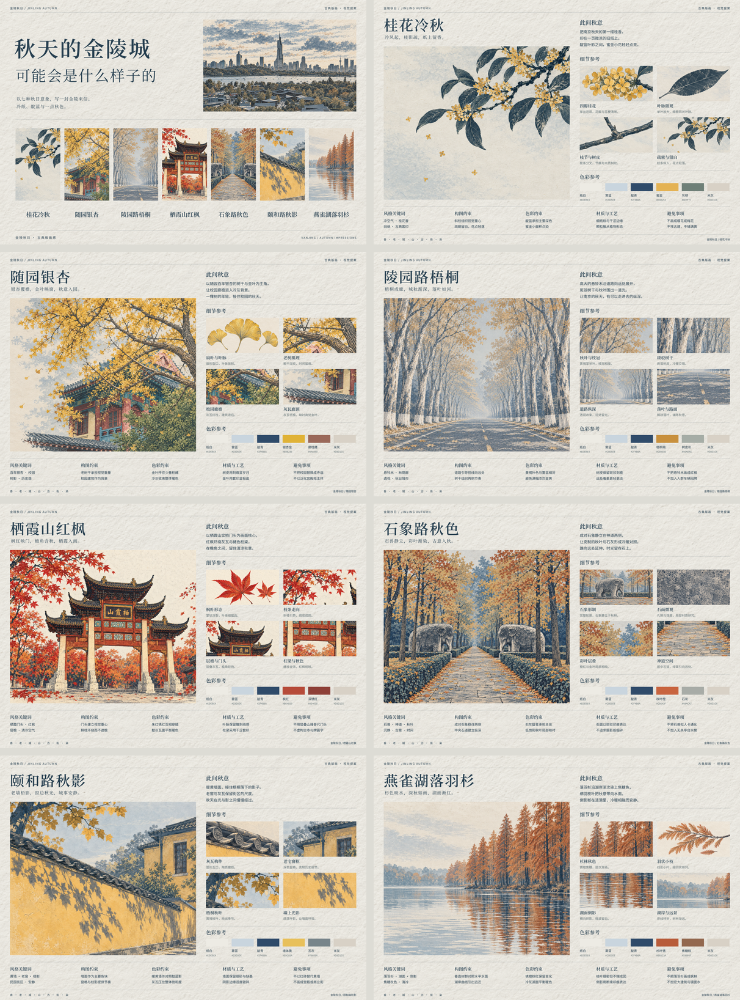

# 金陵秋日 · 古典版画设计 Skill

这是一套**可复用的设计流程与风格技能**：依据真实南京秋景提炼视觉命题，绘制独立插画，再以真实字体和 SVG 完成编辑式排版。已确认的封面与七张主题卡仅作为示范，完整素材与导出程序为辅助，不限制新设计的地点、数量、标题或版式。



## 使用与安装

将 `skills/jinling-autumn-classic-print` 整个文件夹复制到 Codex 的用户 skills 目录（通常为 `~/.codex/skills/`），然后调用 `$jinling-autumn-classic-print`。本仓库本身不是自动安装器，不会修改用户设置。

示例请求：“使用 $jinling-autumn-classic-print，参考我提供的玄武湖实拍，做一张冷调版画封面；紫峰位于插图中央，标题在本地排版。”

## 目录

```text
skills/jinling-autumn-classic-print/
  SKILL.md                  技能入口
  agents/openai.yaml        展示名称与调用提示
  references/               风格、地点锚点、工作流与验收要求
  scripts/                  本地导出与校验
  assets/designs/            每张设计一个文件夹，保存排版与全部素材
  assets/final-designs/      八份最终 SVG 和八张高清 PNG
  assets/overview.png        示例索引总览，不是额外交付尺寸
```

终稿均为 3:2，PNG 为 **6144×4096 全彩无损输出**。SVG 中的文字、线条、色块可编辑，插画是嵌入 PNG，不是纯矢量路径；6K 画布不代表位图凭空增加原生细节。

## 示例

|主题|PNG|SVG|
|---|---|---|
|封面：秋天的金陵城 / 大概是这个样子的|[PNG](skills/jinling-autumn-classic-print/assets/final-designs/00_系列封面.png)|[SVG](skills/jinling-autumn-classic-print/assets/final-designs/00_系列封面.svg)|
|桂花冷秋|[PNG](skills/jinling-autumn-classic-print/assets/final-designs/01_桂花冷秋.png)|[SVG](skills/jinling-autumn-classic-print/assets/final-designs/01_桂花冷秋.svg)|
|随园银杏|[PNG](skills/jinling-autumn-classic-print/assets/final-designs/02_随园银杏.png)|[SVG](skills/jinling-autumn-classic-print/assets/final-designs/02_随园银杏.svg)|
|陵园路梧桐|[PNG](skills/jinling-autumn-classic-print/assets/final-designs/03_陵园路梧桐.png)|[SVG](skills/jinling-autumn-classic-print/assets/final-designs/03_陵园路梧桐.svg)|
|栖霞山红枫|[PNG](skills/jinling-autumn-classic-print/assets/final-designs/04_栖霞山红枫.png)|[SVG](skills/jinling-autumn-classic-print/assets/final-designs/04_栖霞山红枫.svg)|
|石象路秋色|[PNG](skills/jinling-autumn-classic-print/assets/final-designs/05_石象路秋色.png)|[SVG](skills/jinling-autumn-classic-print/assets/final-designs/05_石象路秋色.svg)|
|颐和路秋影|[PNG](skills/jinling-autumn-classic-print/assets/final-designs/06_颐和路秋影.png)|[SVG](skills/jinling-autumn-classic-print/assets/final-designs/06_颐和路秋影.svg)|
|燕雀湖落羽杉|[PNG](skills/jinling-autumn-classic-print/assets/final-designs/07_燕雀湖落羽杉.png)|[SVG](skills/jinling-autumn-classic-print/assets/final-designs/07_燕雀湖落羽杉.svg)|

## 重建

在技能文件夹中执行 `npm install`，安装 Noto Serif SC 与 Noto Sans SC 字体后执行 `npm run build`；运行 `npm run verify` 检查文件与素材。详见 [重建说明](skills/jinling-autumn-classic-print/references/rebuild.md)。

## 公开分享边界

这是准备公开分享的本地项目，**尚未选择整个仓库的许可证，不等于已经授予开源许可**。AI 插画的生成方式、实拍来源用途、字体与授权待办见 [来源和发布说明](skills/jinling-autumn-classic-print/references/provenance.md)。旧参考图、实拍照片、过程候选和字体未包含。

全量高清示例和可重建素材使仓库体积较大；所有文件需通过大小检查。可由维护者后续选择 Git LFS 或 Release 资源分发，但本次未上传也未自动改变存储方式。

本地检查与重建结果见 [验证记录](VALIDATION.md)。

AI 工具和人工贡献边界见 [AI 使用说明](AI_USAGE.md)。方法验证协议与当前结果见 [evaluation](skills/jinling-autumn-classic-print/evaluation/README.md)，真实修订案例见 [case-studies](skills/jinling-autumn-classic-print/case-studies/yihe-road.md)。
